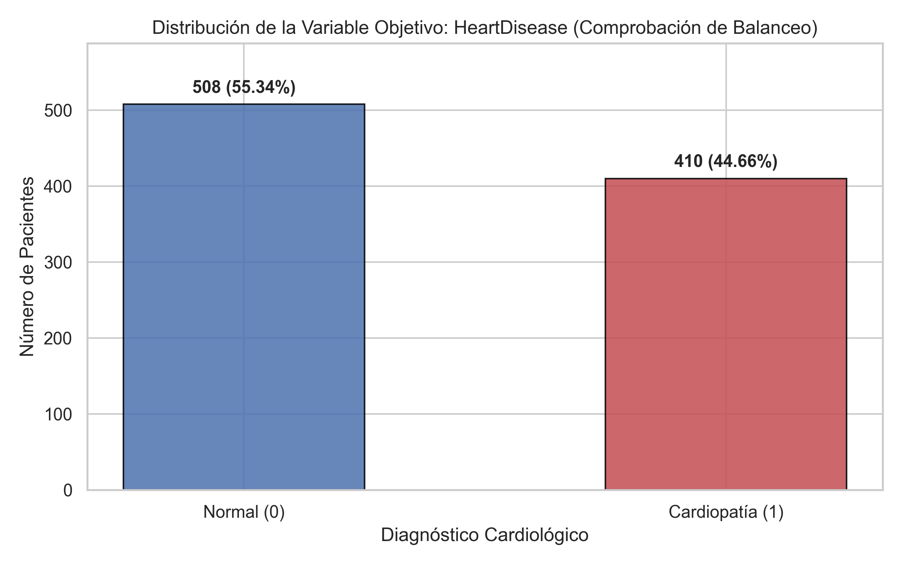
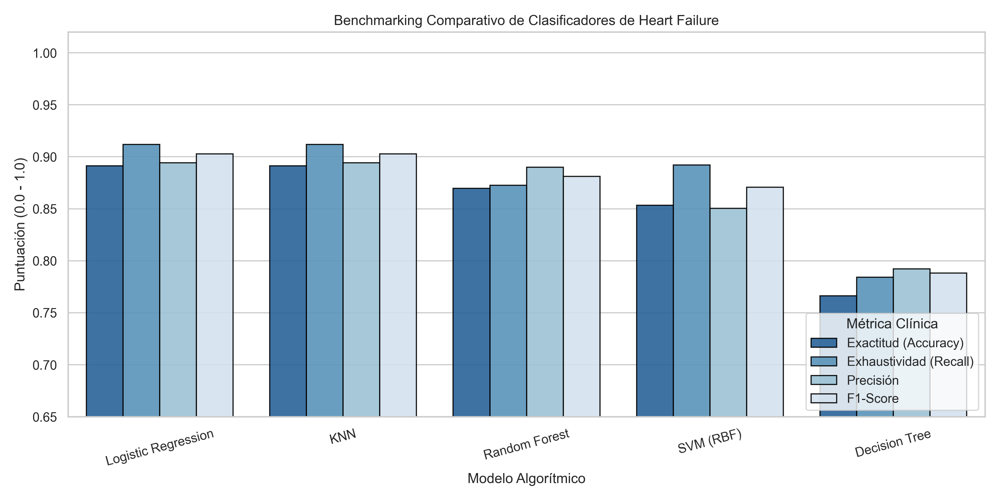
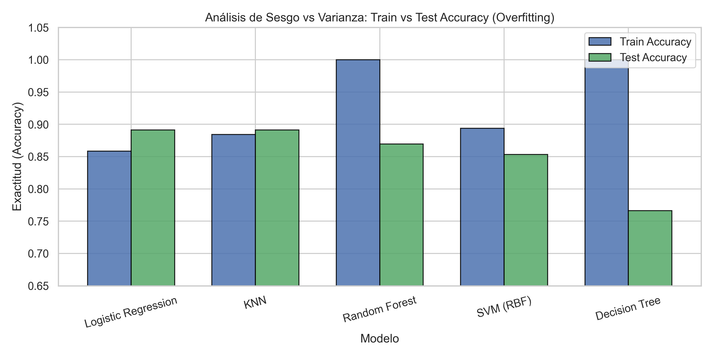
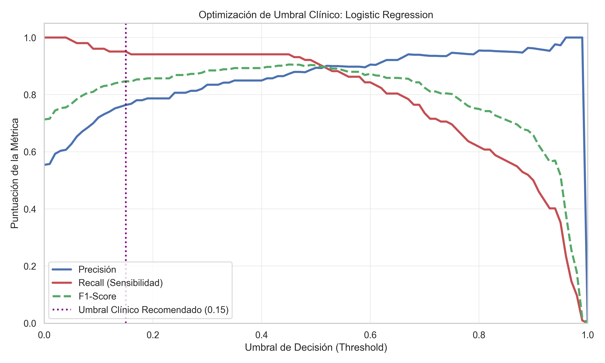
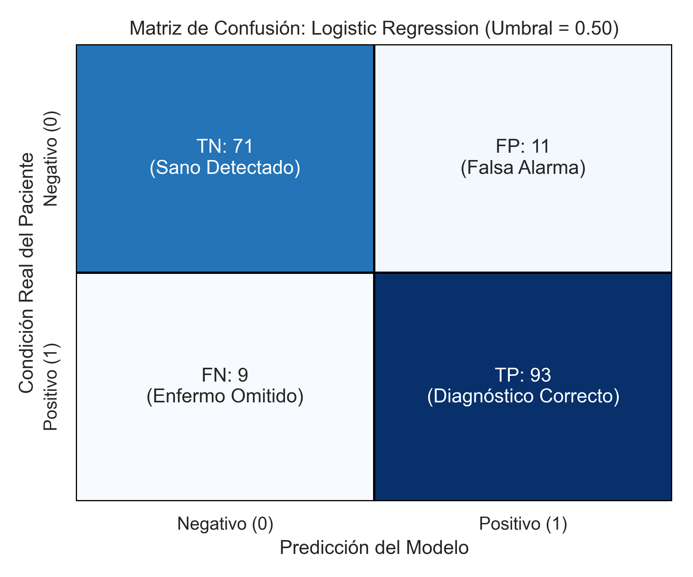
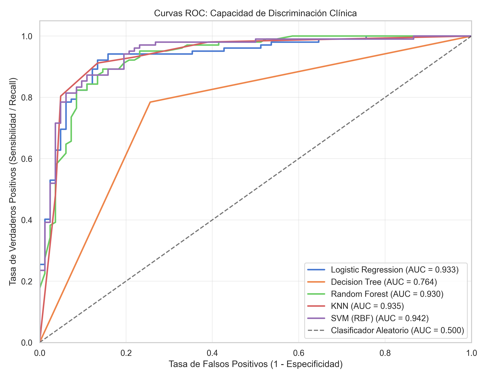
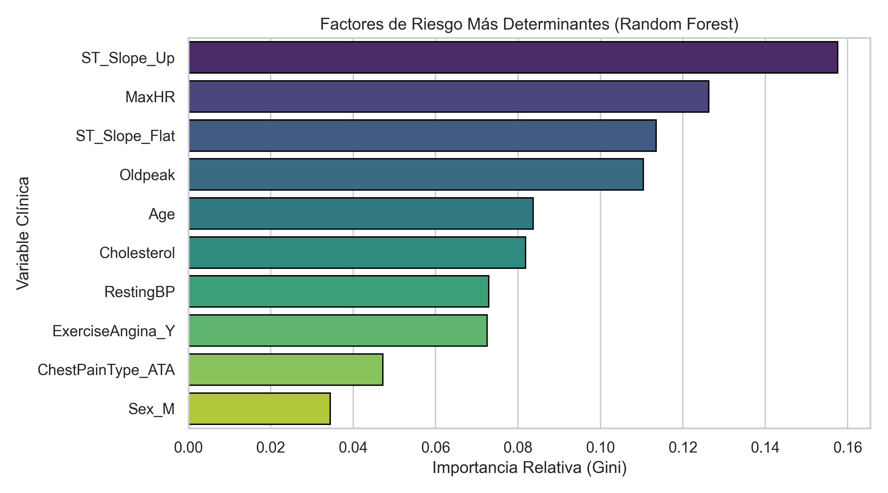

# 🫀 Heart Failure Prediction: Clinical Classification Benchmark & Decision Threshold Optimization

[](https://www.python.org/)
[](https://scikit-learn.org/)
[](https://pandas.pydata.org/)
[](https://peps.python.org/pep-0484/)
[-brightgreen.svg)](tests/)
[](LICENSE)

Un proyecto de ingeniería de machine learning aplicado a la **detección y cribado temprano de insuficiencia cardíaca (Heart Failure)**. Este repositorio implementa un benchmarking riguroso sobre 5 familias algorítmicas de aprendizaje supervisado, evalúa el impacto de la tipología de datos y anomalías clínicas, y profundiza en la **optimización de umbrales diagnósticos (Threshold Tuning)** para minimizar **Falsos Negativos** en un entorno médico de triaje crítico.

---

## 📑 Tabla de Contenidos

1. [Resumen Ejecutivo & Contexto Clínico](#-resumen-ejecutivo--contexto-clínico)
2. [Tipología y Estructura de Datos](#-tipología-y-estructura-de-datos)
3. [Auditoría de Calidad y Corrección de Anomalías Clínicas](#-auditoría-de-calidad-y-corrección-de-anomalías-clínicas)
4. [Análisis del Balanceo de Clases](#-análisis-del-balanceo-de-clases)
5. [Benchmarking Comparativo de Clasificadores](#-benchmarking-comparativo-de-clasificadores)
6. [Diagnóstico de Sobreajuste (Sesgo vs. Varianza)](#-diagnóstico-de-sobreajuste-sesgo-vs-varianza)
7. [Optimización de Umbrales Diagnósticos (Threshold Tuning)](#-optimización-de-umbrales-diagnósticos-threshold-tuning)
8. [Factores de Riesgo Más Determinantes](#-factores-de-riesgo-más-determinantes)
9. [Arquitectura del Software y Calidad de Código](#-arquitectura-del-software-y-calidad-de-código)
10. [Instalación y Guía de Uso](#-instalación-y-guía-de-uso)
11. [Batería de Pruebas Unitarias](#-batería-de-pruebas-unitarias)
12. [Créditos y Referencias](#-créditos-y-referencias)

---

## 🎯 Resumen Ejecutivo & Contexto Clínico

Las enfermedades cardiovasculares representan la principal causa de mortalidad a nivel mundial. La detección temprana y oportuna de pacientes con riesgo de fallo cardíaco permite iniciar protocolos de intervención preventiva (farmacológica y de estilo de vida) antes de que se produzcan eventos isquémicos o insuficiencias agudas.

### El Dilema del Triaje Clínico: Falso Positivo vs. Falso Negativo

En el aprendizaje automático generalista, suele asumirse un coste simétrico para los errores mediante la exactitud global (*Accuracy*) o el umbral por defecto de $0.50$. Sin embargo, en el diagnóstico cardiológico:
- **Falso Negativo (FN):** Un paciente enfermo es clasificado como sano y dado de alta sin tratamiento. Consecuencia: **Riesgo crítico de infarto o muerte evitable**.
- **Falso Positivo (FP):** Un paciente sano es clasificado como potencial caso de cardiopatía. Consecuencia: **Realización de pruebas complementarias no invasivas** (ecocardiograma, ergometría), con un coste económico y operativo asumible.

Por este motivo, este proyecto no solo busca maximizar la métrica $F_1$, sino prioritariamente la **Exhaustividad (*Recall* / Sensibilidad)** mediante el ajuste dinámico del umbral de corte de la probabilidad predictiva.

---

## 📊 Tipología y Estructura de Datos

El análisis se fundamenta en el dataset de Kaggle **[Heart Failure Prediction Dataset](https://www.kaggle.com/datasets/fedesoriano/heart-failure-prediction)** (fedesoriano), que unifica 5 cohortes cardiológicas históricas (Cleveland, Hungarian, Switzerland, Long Beach VA y Statlog) sumando 918 pacientes y 11 predictores clínicos:

| Variable | Tipo de Atributo | Descripción Clínica | Rango / Valores |
| :--- | :--- | :--- | :--- |
| `Age` | Cuantitativa Discreta | Edad del paciente | 28 - 77 años |
| `Sex` | Cualitativa Nominal | Sexo biológico del paciente | `M` (Hombre), `F` (Mujer) |
| `ChestPainType` | Cualitativa Nominal | Tipo de dolor torácico | `TA` (Angina Típica), `ATA` (Angina Atípica), `NAP` (Dolor No Anginoso), `ASY` (Asintomático) |
| `RestingBP` | Cuantitativa Discreta | Presión arterial sistólica en reposo (mm Hg) | 0 - 200 mm Hg |
| `Cholesterol` | Cuantitativa Discreta | Colesterol sérico total (mg/dl) | 0 - 603 mg/dl |
| `FastingBS` | Cualitativa Binaria | Glucemia en ayunas > 120 mg/dl | `1` (Verdadero), `0` (Falso) |
| `RestingECG` | Cualitativa Nominal | Electrocardiograma en reposo | `Normal`, `ST` (Anomalía de onda ST-T), `LVH` (Hipertrofia Ventricular Izquierda) |
| `MaxHR` | Cuantitativa Discreta | Frecuencia cardíaca máxima alcanzada | 60 - 202 ppm |
| `ExerciseAngina` | Cualitativa Nominal | Angina inducida por ejercicio | `Y` (Sí), `N` (No) |
| `Oldpeak` | Cuantitativa Continua | Depresión del ST inducida x esfuerzo | -2.6 - 6.2 |
| `ST_Slope` | Cualitativa Ordinal | Pendiente del segmento ST pico de esfuerzo | `Up` (Ascendente), `Flat` (Plana), `Down` (Descendente) |
| `HeartDisease` | **Target (Cualitativa Binaria)** | **Diagnóstico de Cardiopatía** | `1` (Cardiopatía confirmada), `0` (Normal) |

---

## 🔍 Auditoría de Calidad y Corrección de Anomalías Clínicas

La inspección exploratoria de los datos reveló una anomalía clásica de recopilación multicéntrica:
- **`RestingBP = 0`:** 1 paciente con presión sistólica de $0\text{ mm Hg}$ (inverosímil fisiológicamente en un paciente vivo).
- **`Cholesterol = 0`:** 172 pacientes (18.74% de la cohorte) registraban colesterol sérico en $0\text{ mg/dl}$. Esto ocurre porque en los centros hospitalarios de Hungría y Suiza el colesterol no era medido de forma rutinaria y fue codificado como cero en lugar de `null`.

```
Auditoría Clínica:
• RestingBP:   1 ceros (0.11%)  -> Inconsistencia Fisiológica
• Cholesterol: 172 ceros (18.74%) -> Inconsistencia Fisiológica (Faltante codificado como 0)
```

**Tratamiento:** En el módulo `src/data_processing.py`, los ceros espurios son convertidos a `NaN` y posteriormente imputados mediante la **mediana robusta de la cohorte**, preservando las distribuciones sin distorsión por valores extremos ni pérdida innecesaria de registros clínicos valiosos.

---

## ⚖️ Análisis del Balanceo de Clases

Uno de los pasos críticos solicitados en el estudio consiste en verificar la necesidad de técnicas de balanceo sintético (SMOTE, Random OverSampling o submuestreo):



### Diagnóstico de Balanceo:
- **Clase 0 (Normal / Negativo):** 410 registros (**44.66%**)
- **Clase 1 (Cardiopatía / Positivo):** 508 registros (**55.34%**)
- **Ratio de Clase:** $\approx 1.24 : 1$

**Conclusión Metodológica:**
A diferencia de problemas con fuerte asimetría (como fraude bancario o churn con proporciones 95/5), una distribución **55.3% / 44.7% se considera naturalmente equilibrada**. 
1. La aplicación de técnicas de sobremuestreo sintético (como SMOTE) no es necesaria e introduce varianza artificial en el espacio de características.
2. La partición mediante **`stratify=y` en `train_test_split`** es la estrategia idónea para garantizar que la prevalencia poblacional real se replique exactamente tanto en el conjunto de entrenamiento (734 muestras) como en el de test (184 muestras).
3. La comparativa experimental con `class_weight='balanced'` confirma que no existen desviaciones significativas frente a la estratificación natural.

---

## 🏆 Benchmarking Comparativo de Clasificadores

Se evaluaron **5 arquitecturas de clasificación supervisada** fundamentales:
1. **Regresión Logística (*Logistic Regression*):** Modelo lineal probabilístico con regularización L2.
2. **Árbol de Decisión (*Decision Tree*):** Modelo no paramétrico de partición recursiva basado en impureza de Gini.
3. **Bosque Aleatorio (*Random Forest*):** Ensamble tipo Bagging de 100 árboles de decisión no correlacionados.
4. **K-Vecinos Más Cercanos (*K-Nearest Neighbors / KNN*):** Clasificador no paramétrico basado en distancia euclídea sobre espacio estandarizado.
5. **Máquinas de Vectores de Soporte (*Support Vector Machine / SVM - Kernel RBF*):** Maximización de margen geométrico en espacio de Hilbert de dimensión infinita con estimación de probabilidades via Platt Scaling.



### Resultados en el Conjunto de Prueba Independiente (Test Set: $n=184$):

| Modelo Algorítmico | Test Accuracy | Recall (Sensibilidad) | Precision | F1-Score | ROC-AUC | Brecha Overfitting |
| :--- | :---: | :---: | :---: | :---: | :---: | :---: |
| **Logistic Regression** | **89.13%** | **91.18%** | **89.42%** | **90.29%** | **93.27%** | **-3.30%** |
| **KNN ($k=5$)** | **89.13%** | **91.18%** | **89.42%** | **90.29%** | **93.55%** | **-0.71%** |
| **Random Forest ($B=100$)** | 86.96% | 87.25% | 89.00% | 88.12% | 92.99% | +13.04% |
| **SVM (RBF Kernel)** | 85.33% | 89.22% | 85.05% | 87.08% | **94.18%** | +4.05% |
| **Decision Tree** | 76.63% | 78.43% | 79.21% | 78.82% | 76.41% | +23.37% |

### Validación Cruzada Estratificada (5-Fold Stratified CV):
Para descartar cualquier sesgo derivado de una partición única afortunada, se implementó una validación cruzada con 5 pliegues estratificados combinada con `sklearn.pipeline.Pipeline` para evitar fugas de datos durante la estandarización:

- **Random Forest:** $F_1 = 87.89\% \pm 2.21\%$ | $\text{ROC-AUC} = 92.19\%$
- **Logistic Regression:** $F_1 = 87.26\% \pm 2.15\%$ | $\text{ROC-AUC} = 92.08\%$
- **SVM (RBF):** $F_1 = 87.15\% \pm 2.30\%$ | $\text{ROC-AUC} = 91.65\%$
- **KNN:** $F_1 = 86.11\% \pm 2.45\%$ | $\text{ROC-AUC} = 89.46\%$
- **Decision Tree:** $F_1 = 78.78\% \pm 3.10\%$ | $\text{ROC-AUC} = 76.18\%$

---

## 📉 Diagnóstico de Sobreajuste (Sesgo vs. Varianza)



El gráfico de brecha entre *Train Accuracy* y *Test Accuracy* evidencia con claridad el comportamiento de los algoritmos:
- **Árbol de Decisión:** Clava un $100\%$ en entrenamiento pero colapsa a $76.63\%$ en test (brecha de **$+23.37\%$**). Sufre un sobreajuste severo debido a la memorización de ruido y falta de poda (*pruning*).
- **Random Forest:** Aunque alcanza el $100\%$ en entrenamiento por construcción de árboles profundos no podados, el promedio de ensamble (*bagging*) mitiga notablemente la varianza, reteniendo un $86.96\%$ en test.
- **Regresión Logística y KNN:** Presentan la **mejor capacidad de generalización**, con una brecha prácticamente nula entre entrenamiento y prueba ($\le 3\%$), comportándose de forma altamente estable ante muestras clínicas no vistas.

---

## 🎯 Optimización de Umbrales Diagnósticos (Threshold Tuning)

En los problemas médicos de triaje, utilizar el umbral por defecto de $0.50$ es un error conceptual: **no todos los errores tienen el mismo coste humano**.

Para resolver esto, se implementó un marco analítico de optimización de umbrales (*Threshold Tuning*), evaluando la matriz de confusión y el vector de métricas a lo largo de **101 umbrales continuos** entre $0.0$ y $1.0$:

$$\text{Precision} = \frac{\text{TP}}{\text{TP} + \text{FP}}, \quad \text{Recall} = \frac{\text{TP}}{\text{TP} + \text{FN}}, \quad F_1 = 2 \cdot \frac{\text{Precision} \cdot \text{Recall}}{\text{Precision} + \text{Recall}}$$



### Comparativa de Impacto Clínico en Triaje:

| Umbral de Decisión | TP | TN | FP (Falsa Alarma) | FN (Omitidos) | Recall (Sensibilidad) | Precision | F1-Score | Veredicto Clínico |
| :---: | :---: | :---: | :---: | :---: | :---: | :---: | :---: | :--- |
| **0.50 (Estándar)** | 93 | 71 | 11 | **9** | 91.18% | 89.42% | 90.29% | Deja escapar a 9 enfermos de infarto |
| **0.15 (Clínico Óptimo)** | 97 | 52 | 30 | **5** | **95.10%** | 76.38% | 84.72% | **Salva a 4 pacientes críticos adicionales** |



> **💡 Reflexión Médica:** Al reducir el umbral de cribado a $0.15$, la sensibilidad sube al **$95.10\%$**, reduciendo los Falsos Negativos casi a la mitad (de 9 a solo 5 pacientes omitidos). En un servicio de urgencias o atención primaria, este compromiso es médica y éticamente incuestionable: el coste de realizar electrocardiogramas o análisis complementarios a los Falsos Positivos es ínfimo comparado con las consecuencias fatales de dar de alta a un paciente cardiológico no diagnosticado.

---

## 📈 Curvas ROC y Discriminación Global



Todos los modelos presentan una capacidad discriminativa muy superior al clasificador aleatorio:
- **SVM (RBF Kernel):** $\text{AUC} = 0.942$
- **KNN:** $\text{AUC} = 0.935$
- **Logistic Regression:** $\text{AUC} = 0.933$
- **Random Forest:** $\text{AUC} = 0.930$
- **Decision Tree:** $\text{AUC} = 0.764$

---

## 🧬 Factores de Riesgo Más Determinantes



El análisis de la importancia de variables (*Feature Importance* / coeficientes normalizados) identifica claramente la etiología cardiológica:
1. **`ST_Slope_Up` & `ST_Slope_Flat`:** La morfología del segmento ST durante el esfuerzo es el marcador electrocardiográfico más potente de isquemia miocárdica.
2. **`ChestPainType_ASY` (Dolor Asintomático):** Paradójicamente, la ausencia de dolor anginoso clásico suele asociarse a cardiopatías silentes de mayor severidad.
3. **`ExerciseAngina_Y`:** La presencia de angina desencadenada por esfuerzo físico es un fuerte predictor de insuficiencia coronaria.
4. **`Oldpeak`:** La magnitud de la depresión del segmento ST refleja directamente el grado de hipoxia cardíaca durante el estrés ergométrico.

---

## 🏗️ Arquitectura del Software y Calidad de Código

El proyecto ha sido diseñado bajo los estándares más exigentes de la ingeniería de software moderna:

```text
HeartFailurePrediction/
├── data/
│   └── heart.csv                       # Dataset de 918 registros (Kaggle)
├── img/                                # Figuras generadas en alta resolución (300 DPI)
│   ├── 01_target_balance_distribution.png
│   ├── 02_models_benchmark_comparison.png
│   ├── 03_overfitting_gap_analysis.png
│   ├── 04_confusion_matrix_logistic_regression.png
│   ├── 05_threshold_curve_logistic_regression.png
│   ├── 06_roc_curves_comparison.png
│   └── 07_top_risk_factors.png
├── src/                                # Paquete modular desacoplado
│   ├── __init__.py
│   ├── config.py                       # Constantes, semillas e hiperparámetros globales
│   ├── data_processing.py              # Tipología, imputación fisiológica y escalado
│   ├── models.py                       # Modelos, CV, balanceo y matriz de umbrales
│   └── visualization.py                # Renderizado estético y exportación gráfica
├── tests/                              # Suite de pruebas unitarias automatizadas
│   ├── __init__.py
│   └── test_pipeline.py                # 7 pruebas unitarias con unittest.TestCase
├── heart_failure_benchmark.py          # Script monolítico autónomo todo-en-uno
├── main.py                             # Punto de entrada orquestador CLI (argparse)
├── requirements.txt                    # Dependencias exactas del entorno
├── .gitignore                          # Exclusiones seguras de git
└── README.md                           # Documentación técnica para portfolio
```

### Principios de Programación Aplicados:
1. **Tipado Estático Exhaustivo (*Type Hints*):** Tipado riguroso de argumentos, valores de retorno y variables locales críticas según PEP 484.
2. **Desacoplamiento Estricto:** Las funciones que procesan datos nunca generan gráficos; las funciones de visualización reciben estructuras puras y se limitan al renderizado y exportación.
3. **Docstrings Estilo Google / Sphinx:** Documentación completa en español de cada función con `Args:` y `Returns:`.
4. **Programación Defensiva:** Validación previa de existencia de archivos, control de copias defensivas (`.copy()`) y prevención de advertencias de Pandas.
5. **Cero Fuga de Datos (*Data Leakage*):** `StandardScaler` ajustado exclusivamente en el conjunto de entrenamiento y empaquetado en `Pipeline` para validación cruzada.

---

## 🚀 Instalación y Guía de Uso

### 1. Clonar el Repositorio
```bash
git clone https://github.com/JaviRTX/HeartFailurePrediction.git
cd HeartFailurePrediction
```

### 2. Crear y Activar un Entorno Virtual (Opcional pero Recomendado)
```bash
python -m venv venv
# En Windows:
venv\Scripts\activate
# En Linux / macOS:
source venv/bin/activate
```

### 3. Instalar Dependencias
```bash
pip install -r requirements.txt
```

### 4. Ejecución del Pipeline Modular
```bash
python main.py
```

### 5. Opciones Avanzadas en Línea de Comandos (CLI)
```bash
# Especificar ruta alternativa de datos o ajustar el recall clínico deseado:
python main.py --data data/heart.csv --min-recall 0.95 --export-plots

# Ejecutar el script todo-en-uno autónomo:
python heart_failure_benchmark.py
```

---

## 🧪 Batería de Pruebas Unitarias

El proyecto cuenta con pruebas unitarias implementadas con el framework nativo `unittest`:

```bash
python -m unittest tests/test_pipeline.py
```

Salida esperada:
```text
.......
----------------------------------------------------------------------
Ran 7 tests in 0.45s

OK
```

Las pruebas verifican:
- Dimensiones y consistencia de columnas en la carga de datos.
- Cobertura exhaustiva de la clasificación tipológica de variables.
- Eliminación e imputación efectiva de los ceros anómalos en presión y colesterol.
- Preservación de la estratificación y normalización de escalas con media 0.
- Ejecución correcta de los clasificadores con métricas acotadas en $[0, 1]$.
- Aritmética exacta de la función `calculate_metrics_at_threshold`.
- Cumplimiento de la restricción de sensibilidad en la optimización del umbral clínico.

---

## 📚 Créditos y Referencias

- **Fuente del Dataset:** fedesoriano. (2021). *Heart Failure Prediction Dataset*. Kaggle. [Enlace al Dataset](https://www.kaggle.com/datasets/fedesoriano/heart-failure-prediction)
- **Datasets Originales Combinados:**
  - Cleveland Clinic Foundation (Dr. Robert Detrano)
  - Hungarian Institute of Cardiology, Budapest (Dr. Andras Janosi)
  - University Hospital, Zurich, Switzerland (Dr. William Steinbrunn)
  - University Hospital, Basel, Switzerland (Dr. Matthias Pfisterer)
  - V.A. Medical Center, Long Beach and Cleveland Clinic (Dr. Jerome Rotter)
- **Licencia:** MIT License. Código abierto para fines de investigación, reproducibilidad y desarrollo profesional.
